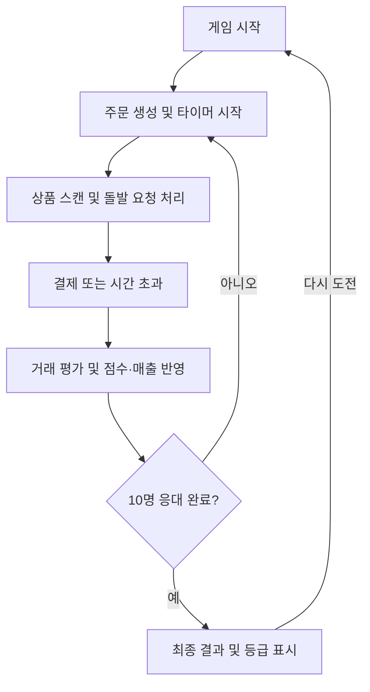
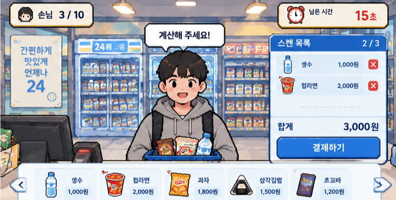

# 🛒 계산 좀 해주세요! — CHECKOUT PLEASE!

> AI응용게임기획및프로그래밍 프로젝트

편의점 아르바이트생이 되어 손님의 상품을 스캔하고 돌발 요청에 대응하는 1인용 2D 캐주얼 타임 매니지먼트 웹 게임입니다. 제한 시간 안에 손님 10명을 응대하고 높은 근무 등급을 획득하는 것이 목표입니다.

- 🌐 [게임 소개 페이지](https://kiwi031014-hue.github.io/CHECKOUT-PLEASE/)
- 🎮 [게임 플레이](https://kiwi031014-hue.github.io/CHECKOUT-PLEASE/game.html)
- 📝 [AI 활용 프롬프트](https://kiwi031014-hue.github.io/CHECKOUT-PLEASE/prompts.html)

## 기획 의도

일상적인 편의점 계산 업무에 시간 제한과 돌발 상황을 결합하여 빠른 판단과 정확한 상품 처리가 요구되는 게임을 기획했습니다. 마우스만으로 쉽게 조작할 수 있으며 짧은 플레이 시간 안에 성취감을 느끼도록 구성했습니다.

## 🎮 주요 기능

| 구분 | 내용 |
|---|---|
| 플랫폼 | PC 웹 브라우저, 1인 플레이 |
| 상품 | 8종, 손님별 최초 1~4개 무작위 선택 |
| 상품 스캔 | 상품 클릭으로 장바구니 추가, − 버튼으로 취소 |
| 자동 계산 | 상품 가격 합산 및 할인 반영 |
| 시간 제한 | 손님당 20초 |
| 돌발 이벤트 | 상품 추가, 취소, 500원 할인 쿠폰 |
| 거래 평가 | 주문과 스캔 목록, 쿠폰 적용 여부 비교 |
| 결과 | 점수, 성공 거래, 매출, 실패 횟수, S~C 등급 |
| 재시작 | 모든 거래 및 점수 초기화 |

## 플레이 방법

1. 게임 시작 버튼을 누릅니다.
2. 손님의 주문에 맞춰 상품을 클릭합니다.
3. 추가·취소 요청이나 쿠폰 요청이 발생하면 반영합니다.
4. 결제 버튼을 눌러 거래를 완료하고 다음 손님으로 이동합니다.
5. 10명 응대 후 결과를 확인합니다.

## 점수 및 등급

| 조건 | 점수 |
|---|---:|
| 정상 결제 | +100 |
| 10초 이내 정상 결제 | 추가 50 |
| 돌발 요청을 반영한 정상 결제 | 추가 50 |
| 계산 오류 또는 시간 초과 | 0 |

| 등급 | 점수 |
|---|---:|
| S | 1600 이상 |
| A | 1200~1599 |
| B | 800~1199 |
| C | 800 미만 |

## 🧩 시스템 구조



상품 정보는 `data.js`에서 관리하며, 주문 생성·타이머·이벤트·결제 판정·결과 집계는 `game.js`가 담당합니다. 게임 실행 중 외부 AI API는 호출하지 않습니다.

## 📸 화면 기획

아래 이미지는 중간 과제 기획서의 와이어프레임이며 실제 실행 화면과는 차이가 있습니다. 현재 플레이 화면에서는 상품과 손님을 이모지로 표현합니다.

| 시작 화면 | 플레이 화면 | 결과 화면 |
|---|---|---|
|  |  |  |

## 📁 파일 구조

```text
CHECKOUT-PLEASE/
├── index.html    # 게임 소개
├── game.html     # 플레이 화면
├── game.js       # 게임 로직
├── data.js       # 상품 데이터
├── style.css     # 공통 디자인
├── prompts.html  # AI 프롬프트 정리
├── assets/       # 기획 이미지
└── README.md     # 개발 문서
```

## 🛠 개발 과정 및 도구

1. 게임 아이디어 및 핵심 규칙 기획
2. 시작·플레이·결과 화면 와이어프레임 구성
3. ChatGPT를 활용한 HTML/CSS/JavaScript 코드 제작
4. 상품 스캔과 자동 합계, 타이머, 돌발 이벤트, 결과 시스템 구현
5. GitHub Pages 배포 설정

개발 환경: HTML, CSS, JavaScript / ChatGPT / GitHub Pages. 별도의 라이브러리나 서버 설치가 필요하지 않습니다. 로컬에서는 `index.html`을 브라우저로 열 수 있습니다.

## 📝 AI 활용 기록

[단계별 개발 프롬프트 보기](prompts.html) · [웹페이지로 보기](https://kiwi031014-hue.github.io/CHECKOUT-PLEASE/prompts.html)

AI는 기획 정리, UI 구성, 코드 생성 및 개발 요구사항 구체화에 활용했습니다. 프롬프트 페이지는 개발 요구사항을 바탕으로 재구성한 기록이며 실제 대화 원문 전체를 옮긴 것은 아닙니다.

## 구현 범위 및 개선 과제

- 기획서에 명시되지 않은 상품 5종의 가격, 쿠폰 금액, 등급 기준은 구현 기본값으로 설정했습니다.
- 첫 세 손님에게 추가·취소·쿠폰 이벤트가 각각 발생하며 이후에는 무작위로 결정됩니다.
- 멀티플레이, 온라인 랭킹, 재고 관리 등은 현재 범위에서 제외했습니다.
- 향후 그래픽 개선과 전체 브라우저 플레이 검증이 필요합니다.
